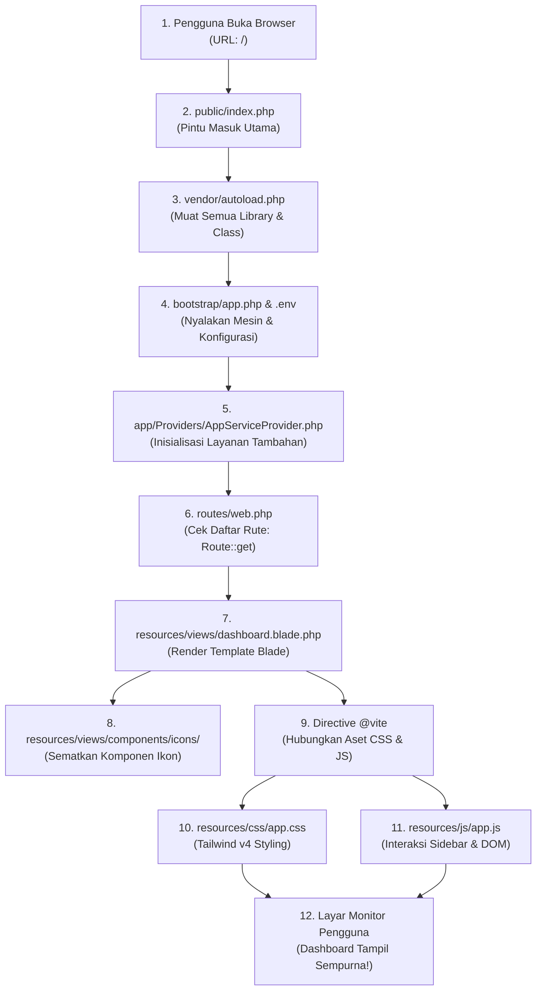

# 🧭 Panduan Alur Sistem Kepesertaan (File-by-File Lifecycle)

Selamat datang kembali di dunia web development! Dokumen ini dibuat khusus untuk membedah bagaimana alur kerja aplikasi **Sistem Kepesertaan** berjalan dari hulu ke hilir. 

Panduan ini disusun dari **sudut pandang perpindahan file**: *file apa yang pertama kali dieksekusi, ke mana arah alurnya, siapa yang membaca data, hingga bagaimana halaman akhirnya muncul di layar monitor pengguna.*

---

## 🍽️ Analogi Sederhana: Sistem ini Ibarat "Restoran Modern"

Agar tidak pusing dengan istilah teknis yang rumit, bayangkan alur sistem ini seperti memesan makanan di restoran:

| Peran di Restoran | File / Komponen di Laravel | Tugasnya |
| :--- | :--- | :--- |
| **Pintu Masuk & Resepsionis** | [`public/index.php`](file:///c:/laragon/www/sistem-kepesertaan/public/index.php) | Menyambut setiap pengunjung yang datang. |
| **Manajer Operasional** | [`bootstrap/app.php`](file:///c:/laragon/www/sistem-kepesertaan/bootstrap/app.php) | Menyiapkan peralatan dapur dan menyalakan listrik. |
| **Buku Pengaturan Rahasia** | [`.env`](file:///c:/laragon/www/sistem-kepesertaan/.env) | Menyimpan password database dan kunci rahasia. |
| **Buku Menu Restoran** | [`routes/web.php`](file:///c:/laragon/www/sistem-kepesertaan/routes/web.php) | Mencocokkan apa yang diminta pengunjung dengan hidangan yang tersedia. |
| **Koki & Piring Saji** | [`resources/views/dashboard.blade.php`](file:///c:/laragon/www/sistem-kepesertaan/resources/views/dashboard.blade.php) | Meracik struktur HTML dan bahan tampilan. |
| **Hiasan & Bumbu Pelengkap** | [`resources/views/components/icons/`](file:///c:/laragon/www/sistem-kepesertaan/resources/views/components/icons) | Ikon-ikon modular yang siap ditaburkan ke piring. |
| **Dekorasi & Tata Cahaya** | [`resources/css/app.css`](file:///c:/laragon/www/sistem-kepesertaan/resources/css/app.css) | Mempercantik warna, font, dan bayangan via Tailwind CSS. |
| **Pelayan Interaktif** | [`resources/js/app.js`](file:///c:/laragon/www/sistem-kepesertaan/resources/js/app.js) | Melayani aksi langsung (klik tombol buka/tutup menu). |

---

## 🗺️ Diagram Alur Eksekusi (Dari Request Sampai Layar)



---

## 🔍 Penjelasan Detail Langkah demi Langkah (File-by-File)

### Langkah 1: Pintu Masuk Pertama Kali
* **File:** [`public/index.php`](file:///c:/laragon/www/sistem-kepesertaan/public/index.php)
* **Apa yang terjadi:**
  Saat pengguna mengetikkan alamat web di browser, Web Server (Apache/Nginx di Laragon) selalu mengarahkan permintaan pertama kali ke file ini (*Front Controller*).
* **Fungsi utama di dalamnya:**
  1. Menghitung waktu mulai sistem (`LARAVEL_START`).
  2. Mengecek apakah aplikasi sedang dalam mode perbaikan (*maintenance mode*).
  3. Memanggil file autoloader Composer.

---

### Langkah 2: Pemuatan Library Otomatis (Autoloading)
* **File:** `vendor/autoload.php` (dihasilkan oleh Composer via [`composer.json`](file:///c:/laragon/www/sistem-kepesertaan/composer.json))
* **Apa yang terjadi:**
  Di PHP kuno, kita sering menulis puluhan `include` atau `require` manual di atas file. Di Laravel modern, file `autoload.php` ini membuat semua *class*, *library*, dan *package* (seperti Pest, Laravel Framework, dsb.) langsung siap dipanggil secara otomatis kapan pun dibutuhkan.

---

### Langkah 3: Inisialisasi Aplikasi (Bootstrap) & Membaca Konfigurasi
* **File:** [`bootstrap/app.php`](file:///c:/laragon/www/sistem-kepesertaan/bootstrap/app.php) dan [`.env`](file:///c:/laragon/www/sistem-kepesertaan/.env)
* **Apa yang terjadi:**
  1. Sistem membaca file [`.env`](file:///c:/laragon/www/sistem-kepesertaan/.env) untuk mengetahui pengaturan rahasia (koneksi database, nama aplikasi, mode debug `APP_DEBUG=true`).
  2. File [`bootstrap/app.php`](file  :///c:/laragon/www/sistem-kepesertaan/bootstrap/app.php) dijalankan untuk menyatukan tiga pilar utama:
     - **Routing:** Mendaftarkan file rute web dan konsol.
     - **Middleware:** Pengawal keamanan (seperti proteksi CSRF, session).
     - **Exceptions:** Pengendali penanganan error.

> 💡 **Penyegar Memori (Laravel 11+ / 13):**
> Jika Anda ingat Laravel versi terdahulu (versi 7–10) yang punya file `app/Http/Kernel.php` dan folder panjang di `app/Providers/RouteServiceProvider.php`, sekarang semuanya telah disederhanakan menjadi **satu file tunggal** yang bersih di [`bootstrap/app.php`](file:///c:/laragon/www/sistem-kepesertaan/bootstrap/app.php)!

---

### Langkah 4: Registrasi Layanan Tambahan (Service Provider)
* **File:** [`app/Providers/AppServiceProvider.php`](file:///c:/laragon/www/sistem-kepesertaan/app/Providers/AppServiceProvider.php)
* **Apa yang terjadi:**
  File ini didaftarkan melalui [`bootstrap/providers.php`](file:///c:/laragon/www/sistem-kepesertaan/bootstrap/providers.php). Di sinilah tempat menaruh instruksi global sebelum aplikasi melayani pengguna (misalnya: aturan paginasi, schema database default, atau observer model).

---

### Langkah 5: Mencocokkan Permintaan URL (Routing)
* **File:** [`routes/web.php`](file:///c:/laragon/www/sistem-kepesertaan/routes/web.php)
* **Apa yang terjadi:**
  Laravel memeriksa URL yang diminta pengguna. Saat pengguna mengakses halaman utama (`/`):
  ```php
  Route::get('/', function () {
      return view('dashboard');
  });
  ```
  Sistem melihat: *"Ada yang membuka URL root `/`. Perintahnya adalah tampilkan view bernama `dashboard`!"*

---

### Langkah 6: Meracik Tampilan Utama (Blade Engine)
* **File:** [`resources/views/dashboard.blade.php`](file:///c:/laragon/www/sistem-kepesertaan/resources/views/dashboard.blade.php)
* **Apa yang terjadi:**
  Laravel mencari file Blade dengan nama `dashboard.blade.php` di dalam folder `resources/views/`.
  1. Menyusun struktur halaman HTML (`<!DOCTYPE>`, `<head>`, `<body>`).
  2. Merender header fixed di bagian atas (judul aplikasi, profil singkat, dan tombol logout).
  3. Merender navigasi sidebar (daftar menu seperti *Dashboard, Info PKS, Pembagian BU per RO, Wasrik*, dll).
  4. Merender area konten utama (`<main>`).

---

### Langkah 7: Merakit Komponen Ikon Modular
* **Folder:** [`resources/views/components/icons/`](file:///c:/laragon/www/sistem-kepesertaan/resources/views/components/icons)
* **Apa yang terjadi:**
  Ketika di dalam `dashboard.blade.php` terdapat tag khusus seperti:
  ```html
  <x-icons.dashboard></x-icons.dashboard>
  <x-icons.menu></x-icons.menu>
  ```
  Blade secara otomatis mencari file terkait di [`resources/views/components/icons/dashboard.blade.php`](file:///c:/laragon/www/sistem-kepesertaan/resources/views/components/icons/dashboard.blade.php). Kode SVG ikon tersebut diinjeksikan secara modular lengkap dengan atribut kelas warna atau ukurannya.

---

### Langkah 8: Penghubung Frontend Modern (Vite Directive)
* **File:** [`vite.config.js`](file:///c:/laragon/www/sistem-kepesertaan/vite.config.js) & [`package.json`](file:///c:/laragon/www/sistem-kepesertaan/package.json)
* **Apa yang terjadi:**
  Di baris 15 file `dashboard.blade.php`, terdapat kode:
  ```html
  @vite(['resources/css/app.css', 'resources/js/app.js'])
  ```
  Ini adalah directive cerdas Laravel:
  - **Saat Development (`npm run dev`):** Menghubungkan browser langsung ke server Vite lokal yang memiliki fitur *Hot Module Replacement* (HMR). Saat Anda mengubah CSS/JS, browser otomatis terupdate seketika tanpa perlu refresh manual.
  - **Saat Production (`npm run build`):** Membaca file [`public/build/manifest.json`](file:///c:/laragon/www/sistem-kepesertaan/public/build/manifest.json) dan memuat file CSS/JS yang sudah dikompresi serta di-minify demi kecepatan loading maksimal.

> 💡 **Penyegar Memori (Vite vs Webpack / Mix):**
> Dulu Laravel menggunakan Laravel Mix (Webpack) yang lambat saat *compile*. Sejak Laravel 9+, ekosistem beralih ke **Vite** yang kecepatannya nyaris instan.

---

### Langkah 9: Mempercantik Tampilan Visual (Tailwind CSS v4)
* **File:** [`resources/css/app.css`](file:///c:/laragon/www/sistem-kepesertaan/resources/css/app.css)
* **Apa yang terjadi:**
  1. Mengunduh font Google modern (*Poppins* untuk heading, *Inter* untuk teks isi).
  2. Mengaktifkan utilitas Tailwind CSS v4.
  3. Membaca konfigurasi tema khusus di blok `@theme` (warna resmi seperti `primary-biru`, `primary-hijau`, dan `dark`).
  4. Menerapkan gaya kartu profil (`.card`) dan efek hover menu navigasi (`.menu-list`).

---

### Langkah 10: Menjalankan Interaksi di Browser Pengguna (JavaScript)
* **File:** [`resources/js/app.js`](file:///c:/laragon/www/sistem-kepesertaan/resources/js/app.js)
* **Apa yang terjadi:**
  Setelah halaman selesai dimuat di layar pengguna, file JavaScript ini aktif mengawasi interaksi:
  1. Menangkap tombol hamburger `#button_list_sidebar`.
  2. Saat tombol diklik pada layar smartphone, fungsi `toggleSidebar()` dijalankan:
     - Menggeser sidebar keluar/masuk menggunakan animasi transform CSS (`-translate-x-full`).
     - Menampilkan atau menyembunyikan backdrop overlay semi-transparan (`#sidebar_backdrop`).
  3. Jika pengguna mengetuk area backdrop di luar menu, sidebar otomatis menutup kembali.

---

## 🗄️ Lapisan Database (Persiapan Data Masa Depan)

Meskipun saat ini halaman masih berupa layout dashboard, fondasi database di aplikasi ini sudah siap:

1. **Konfigurasi Database:** [`config/database.php`](file:///c:/laragon/www/sistem-kepesertaan/config/database.php) membaca tipe database dari file [`.env`](file:///c:/laragon/www/sistem-kepesertaan/.env) (default Laragon: MySQL dengan database `sistem-kepesertaan`).
2. **Struktur Tabel (Migrations):** Disimpan di [`database/migrations/`](file:///c:/laragon/www/sistem-kepesertaan/database/migrations). File-file ini seperti *blueprint* arsitek untuk membuat tabel `users`, `cache`, dan `jobs` di MySQL tanpa perlu query SQL manual.
3. **Model Eloquent:** [`app/Models/User.php`](file:///c:/laragon/www/sistem-kepesertaan/app/Models/User.php) adalah representasi tabel di PHP. Berkat Eloquent, kita cukup menulis `User::all()` atau `User::find(1)` daripada menulis `SELECT * FROM users`.

---

## 📋 Tabel Kamus File (Quick Cheat Sheet)

Jika Anda ingin mengubah sesuatu di kemudian hari, gunakan panduan cepat ini:

| Mau Mengubah Apa? | File yang Harus Diedit |
| :--- | :--- |
| **Menambah halaman / rute URL baru** | [`routes/web.php`](file:///c:/laragon/www/sistem-kepesertaan/routes/web.php) |
| **Mengubah tata letak navbar / sidebar / isi dashboard** | [`resources/views/dashboard.blade.php`](file:///c:/laragon/www/sistem-kepesertaan/resources/views/dashboard.blade.php) |
| **Membuat bentuk ikon baru** | Tambah file di [`resources/views/components/icons/`](file:///c:/laragon/www/sistem-kepesertaan/resources/views/components/icons) |
| **Mengubah warna tema, font, atau efek shadow** | [`resources/css/app.css`](file:///c:/laragon/www/sistem-kepesertaan/resources/css/app.css) |
| **Mengubah animasi klik tombol / interaksi UI** | [`resources/js/app.js`](file:///c:/laragon/www/sistem-kepesertaan/resources/js/app.js) |
| **Ganti password database / URL server** | [`.env`](file:///c:/laragon/www/sistem-kepesertaan/.env) |
| **Menambah kolom tabel database baru** | Buat migration di [`database/migrations/`](file:///c:/laragon/www/sistem-kepesertaan/database/migrations) |

---

*Dokumen ini dibuat otomatis sebagai panduan arsitektur sistem proyek **Sistem Kepesertaan**.*
